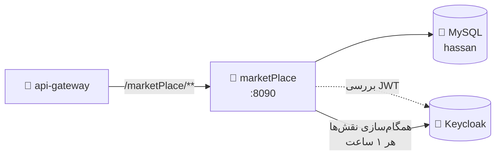

<div align="center">

# 🛒 MarketPlace

**Marketplace service of the Wiki Mount platform**


</div>

---

## 🇬🇧 Overview

A **Spring Boot 4** service for the marketplace part of the platform. It is in an early stage: the security, logging and
Keycloak integration are in place, while the business endpoints are still samples.

- **OAuth2 resource server** validating Keycloak JWTs (realm `my-realm`)
- **Automatic role sync**: on startup and every hour, it scans the controllers' authorities and creates the matching roles in Keycloak
- **MySQL** with JPA, **Jasypt** for encrypted properties, **Logbook** for HTTP logging, **Swagger UI**

Port `8090`, context path `/marketPlace`. Reached through **api-gateway** at `/marketPlace/**`.

---

<div dir="rtl">

## 🇮🇷 راهنمای فارسی

### وضعیت پروژه

این سرویس در مرحله‌ی اولیه است. زیرساخت آماده است (امنیت، Keycloak، لاگ، Swagger)، ولی endpointها فعلاً نمونه‌اند.

</div>



<div dir="rtl">

### امکانات

| امکان | توضیح |
|---|---|
| 🔐 امنیت | همه‌ی مسیرها به‌جز `public/**` توکن Keycloak می‌خواهند |
| 🔄 همگام‌سازی نقش‌ها | موقع شروع و هر یک ساعت، authorityهای کنترلرها خوانده و به‌عنوان role در Keycloak ساخته می‌شوند |
| 🪪 اعتبارسنجی | annotationهای `@NationalCode` (کد ملی) و `@ValidDate` |
| 📜 لاگ | Logbook، همراه با نام کاربر در هر درخواست |
| 🔑 رمزنگاری | مقادیر `ENC(...)` در تنظیمات با Jasypt باز می‌شوند |
| 📖 مستندات | Swagger UI |

### Endpointهای نمونه

| مسیر | دسترسی |
|---|---|
| `GET /marketPlace/public/test1` … `test3` | عمومی |
| `GET /marketPlace/api/test1` … `test3` | با توکن و نقش مخصوص هر مسیر، مثلاً `api.marketplace.api.test1` |

نقش‌های داخل `@PreAuthorize("hasAuthority('...')")` همان‌هایی هستند که همگام‌سازی خودکار در Keycloak می‌سازد؛ کافی است آن‌ها را به کاربر بدهید.

### اجرا روی سیستم خودتان

پیش‌نیاز: Java 21، MySQL با دیتابیس `hassan`، Keycloak با realm `my-realm` و کلاینت‌های `marketPlace` و `adminKeycloack`.

</div>

```bash
./mvnw spring-boot:run
# http://localhost:8090/marketPlace/public/test1
# http://localhost:8090/marketPlace/swagger-ui/index.html
```

<div dir="rtl">

### تنظیمات مهم

| کلید | توضیح |
|---|---|
| `spring.datasource.*` | آدرس، کاربر و رمز MySQL |
| `spring.security.oauth2.resourceserver.jwt.issuer-uri` | آدرس realm در Keycloak |
| `keycloak.serverUrl` / `realm` | آدرس Keycloak و realm |
| `keycloak.clientId` / `clientSecret` | کلاینت `marketPlace` |
| `keycloak.rootClient` | کلاینت ادمین برای ساخت نقش‌ها (`adminKeycloack`) |
| `jasypt.encryptor.password` | کلید باز کردن مقادیر `ENC(...)` |
| `spring.config.import` | آدرس config-server |

### CI/CD

فایل: [`.github/workflows/cicd.yaml`](.github/workflows/cicd.yaml). با هر push روی `master` (یا اجرای دستی):
jar ساخته می‌شود و image به Docker Hub push می‌شود (`hassan233/marketplace:1.0.<run>` و `latest`). deploy خودکار هنوز ندارد.

| Secret | مقدار |
|---|---|
| `DOCKERHUB_TOKEN` | توکن Docker Hub |

برای استفاده در حساب خودتان، `IMAGE_NAME` و نام کاربری `docker login` را در workflow عوض کنید.

### پروژه‌های مرتبط

- [api-gateway](https://github.com/hassanbagheri-developer/api-gateway)
- [core-service](https://github.com/hassanbagheri-developer/core-service)
- [config-server](https://github.com/hassanbagheri-developer/config-server)

</div>

## v3 shop admin API

The API prefix is `/marketPlace/api/admin/shop`. On startup, the existing
role sync creates the `manager` client role in Keycloak. In realm
`my-realm`, assign `Clients > marketPlace > manager` under the user's
role mapping. Sign in through Keycloak using the configured OIDC login
client and obtain a fresh access token after changing role assignments.
The token must include `manager` in
`resource_access.marketPlace.roles`. Send it as `Authorization: Bearer <access_token>`.

| Method and path | Panel operation |
|---|---|
| `GET /session` | Verify access and read the signed-in manager's username |
| `GET /meta`, `GET /dashboard` | Catalog options, sales, recent orders, and stock alerts |
| `GET /products`, `GET /products/{id}` | Search and filter products, and read product details |
| `POST /products`, `PUT /products/{id}`, `DELETE /products/{id}` | Create, edit, and delete products |
| `PATCH /products/{id}/price`, `/stock`, `/status` | Update price, stock, and publication status |
| `POST /products/{id}/duplicate`, `POST /products/bulk` | Duplicate a product or apply bulk actions |
| `GET /orders`, `GET /orders/{id}`, `PATCH /orders/{id}/status` | List, view, and update orders |

Expect HTTP 401 for missing or invalid credentials and HTTP 403 for a
valid token without the shop manager client role. The role grants no
Keycloak realm administration permissions.
